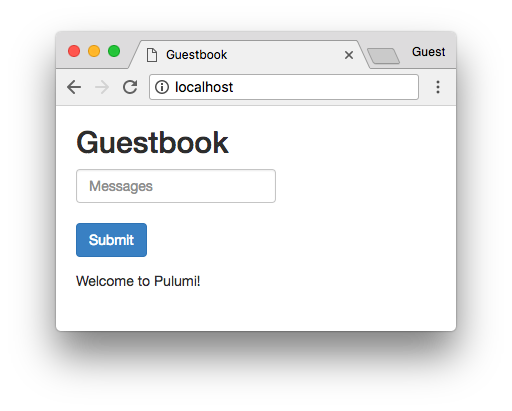

## Prerequisites

1. [Install Pulumi](https://www.pulumi.com/docs/get-started/install/)
2. [Configure Kubernetes](https://www.pulumi.com/docs/intro/cloud-providers/kubernetes/setup/)
3. [Install Node.js](https://www.pulumi.com/docs/intro/languages/javascript/)

## Deploying the example

1.  Create a new stack:

    ```bash
    pulumi stack init dev
    ```

1.  Install dependencies:

    ```bash
    npm install
    ```

1.  Deploy the stack:

    ```bash
    pulumi up
    ```

    ```
    Updating (dev):
        Type                                                        Name                                   Status
    +   pulumi:pulumi:Stack                                         guestbook-easy-dev                     created (23s)
    +   ├─ kubernetes:apps/v1:Deployment                            redis-leader                           created (3s)
    +   ├─ kubernetes:apps/v1:Deployment                            redis-replica                          created (2s)
    +   ├─ kubernetes:apps/v1:Deployment                            guestbook                              created (4s)
    +   ├─ kubernetes:helm.sh/v3:Release                            prometheus                             created (21s)
    +   ├─ kubernetes:core/v1:Namespace                             ingressns                              created (0.01s)
    +   ├─ kubernetes:yaml/v2:ConfigFile                            dashboard                              created
    +   │  └─ kubernetes:core/v1:ConfigMap                          dashboard:default/guestbook-dashboard  created (0.01s)
    +   ├─ kubernetes:helm.sh/v3:Release                            ingresscontroller                      created (0.79s)
    +   ├─ service-monitor:monitoring.coreos.com/v1:ServiceMonitor  guestbook                              created (0.01s)
    +   ├─ kubernetes:core/v1:Service                               redis-replica                          created (10s)
    +   ├─ kubernetes:core/v1:Service                               redis-leader                           created (10s)
    +   ├─ kubernetes:core/v1:Service                               frontend                               created (10s)
    +   └─ kubernetes:networking.k8s.io/v1:Ingress                  guestbook                              created (0.15s)

    Outputs:
       adminPassword: "fizzbuzz123"
       frontendIp   : "127.0.0.1"
       grafanaUrl   : "http://127.0.0.1/grafana"

    Resources:
       + 14 created

    Duration: 24s
    ```

1.  Open the application in your browser to see the running application. If you're running
    macOS you can simply run:

    ```bash
    open $(pulumi stack output frontendIp)
    ```

    > _Note_: if you are deploying to minikube, make sure
    > to run `minikube tunnel` to forward the nginx ingress controller's service to the local
    > machine and access the service via `localhost`. (I do not have a macbook, this
    was tested on WSL2 on Windows 11. The fundamental principles should be the same so it should still work,
    but caveat lector)

    

1.  The Grafana and Prometheus servers are both available from the same host, at the `/grafana`
    and `/prom` paths respectively. There should already be a Guestbook dashboard available to view
    on the Grafana server, and you can debug any potential scrape issues by going to `/prom` and looking at
    `Status > Target health` or `Status > Service discovery`.

## Cleaning up

Once you're finished experimenting, you can destroy your stack and remove it to avoid incurring any additional cost:

```bash
pulumi destroy
pulumi stack rm
```
